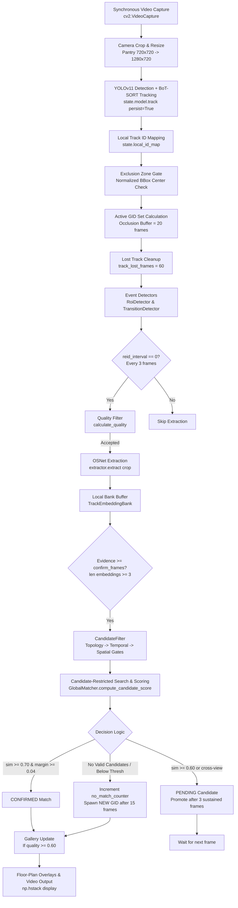

# Multi-Camera Global ID Switching — Comprehensive Architecture Audit

**Target Repository:** `busoft-yuvaraj/multi-camera-person-reid`  
**Configuration Audited:** [config/app_config_new.yaml](file:///c:/Users/Agira/Desktop/cctv-tracker/config/app_config_new.yaml)  
**Clips Evaluated:** `test5_exit.mp4` (waiting_lobby), `test5_panty.mp4` (pantry), `test5_passage.mp4` (passage)  
**Diagnostic Logs Audited:** [logs/association_decisions.jsonl](file:///c:/Users/Agira/Desktop/cctv-tracker/logs/association_decisions.jsonl), [logs/journey.jsonl](file:///c:/Users/Agira/Desktop/cctv-tracker/logs/journey.jsonl), [logs/run_20261013_123759.log](file:///c:/Users/Agira/Desktop/cctv-tracker/logs/run_20261013_123759.log)

---

## Executive Summary

A comprehensive architectural audit was performed on the multi-camera tracking pipeline to determine why Global IDs switch and fragment when people move between the `waiting_lobby`, `pantry`, and `passage` cameras.

The audit revealed that **Global ID switching across cameras is NOT primarily a feature extractor (OSNet) failure, but a architectural gating and state management defect**:
1. **Hard Spatial Rejection on Directionless Transition Memory:** Moving near the pantry sink triggers the `pantry_green` line (bound to `passage`). Even when the person subsequently walks towards `waiting_lobby`, the pipeline retains `last_transition_id = pantry_green`. In `waiting_lobby`, [SpatialGate](file:///c:/Users/Agira/Desktop/cctv-tracker/app/association/spatial_gate.py#L50-L60) classifies `waiting_lobby` as contradictory to `passage` and issues a **hard rejection** (`return False, 0.0`), ignoring crossing direction. This forces the system to reject the true identity (`Person_001`) for 15 frames and spawn a duplicate identity (`Person_003`).
2. **Synchronous Frame Stepping vs. Minimum Transit Time Gate (`TOO_FAST`):** The three camera streams are read in lockstep inside a single `frame_idx` loop. When a person appears in camera transitions, the elapsed time calculated between cameras is `0.0s – 0.3s`. [TemporalGate](file:///c:/Users/Agira/Desktop/cctv-tracker/app/association/temporal_gate.py#L53-L55) enforces a hard `min_seconds: 0.5s` gate, rejecting the legitimate candidate as `TOO_FAST (0.0s < 0.5s)` and forcing false new IDs or incorrect recoveries.
3. **Global ID Lock Hijacking (`_set_active_mapping`):** The identity lock (`lock_confirmed_id`) is strictly bound to `(camera_id, local_track_id)`. When an identity is assigned in a second camera, [JourneyManager._set_active_mapping](file:///c:/Users/Agira/Desktop/cctv-tracker/app/journey/journey_manager.py#L366-L381) deletes the first camera's track from `active_tracks`. The first camera track loses its lock, reverts to `Case B: UNCONFIRMED`, and gets re-assigned to a new Global ID.

Below is the complete trace and answers to questions 1 through 20.

---

## 1. Complete Runtime Flow Trace



1. **Video Frames Input:** [MultiCameraProcessor.run](file:///c:/Users/Agira/Desktop/cctv-tracker/app/multi_camera_processor.py#L256-L379) iterates through configured cameras sequentially on each loop index `frame_idx`.
2. **Crop & Zoom Preprocessing:** If `crop: [0, 0, 720, 720]` is configured (for `pantry`), the frame is sliced and resized to the base resolution `(1280, 720)` ([multi_camera_processor.py:309-313](file:///c:/Users/Agira/Desktop/cctv-tracker/app/multi_camera_processor.py#L309-L313)).
3. **YOLO Detection & BoT-SORT Local Tracking:** `state["model"].track(frame, classes=[0], tracker="botsort.yaml", persist=True, conf=0.25, imgsz=960)` produces bounding boxes and raw track IDs ([multi_camera_processor.py:383-391](file:///c:/Users/Agira/Desktop/cctv-tracker/app/multi_camera_processor.py#L383-L391)).
4. **Local Track ID Isolation:** Raw tracker IDs are mapped to camera-local sequential IDs via `state["local_id_map"]` to prevent tracker ID clashes between cameras ([multi_camera_processor.py:404-413](file:///c:/Users/Agira/Desktop/cctv-tracker/app/multi_camera_processor.py#L404-L413)).
5. **Exclusion Zone Filtering:** Normalized bbox center `(cx, cy)` is checked against `exclusion_zones` ([multi_camera_processor.py:420-437](file:///c:/Users/Agira/Desktop/cctv-tracker/app/multi_camera_processor.py#L420-L437)).
6. **Active Global ID Construction:** GIDs seen within `occlusion_buffer_frames: 20` or active in other cameras within 5 frames are marked active ([multi_camera_processor.py:446-474](file:///c:/Users/Agira/Desktop/cctv-tracker/app/multi_camera_processor.py#L446-L474)).
7. **Disappearance Handling:** Disappeared tracks (> `track_lost_frames: 60`) trigger [JourneyManager.on_track_lost](file:///c:/Users/Agira/Desktop/cctv-tracker/app/journey/journey_manager.py#L223-L260) and are evicted from `state["global_assignments"]`.
8. **Event Detection:** [RoiDetector.check_rois](file:///c:/Users/Agira/Desktop/cctv-tracker/app/events/roi_detector.py#L75-L100) and [TransitionDetector.check_transitions](file:///c:/Users/Agira/Desktop/cctv-tracker/app/events/transition_detector.py#L95-L173) detect entry/exit and line crossings using bottom-center foot points.
9. **OSNet Embedding Extraction:** Every `reid_interval: 3` frames, crops passing [calculate_quality](file:///c:/Users/Agira/Desktop/cctv-tracker/app/reid/quality.py#L4-L43) are passed to OSNet (`extractor.extract([crop])`). Embeddings are added to [TrackEmbeddingBank](file:///c:/Users/Agira/Desktop/cctv-tracker/app/reid/embedding_bank.py#L19-L53) with viewpoint and PAR metadata.
10. **Candidate Generation & Gating:** [AssociationManager.associate_track](file:///c:/Users/Agira/Desktop/cctv-tracker/app/association/association_manager.py#L50-L408) invokes [CandidateFilter.filter_candidates](file:///c:/Users/Agira/Desktop/cctv-tracker/app/association/candidate_filter.py#L31-L134) which passes candidate GIDs through [TopologyGate](file:///c:/Users/Agira/Desktop/cctv-tracker/app/association/topology.py#L20-L34), [TemporalGate](file:///c:/Users/Agira/Desktop/cctv-tracker/app/association/temporal_gate.py#L21-L67), and [SpatialGate](file:///c:/Users/Agira/Desktop/cctv-tracker/app/association/spatial_gate.py#L13-L63).
11. **Scoring & Global ID Assignment:** Valid candidates are scored via [GlobalMatcher.compute_candidate_score](file:///c:/Users/Agira/Desktop/cctv-tracker/app/reid/matcher.py#L113-L243). Matches meeting thresholds are confirmed immediately or promoted from PENDING. If no valid candidates exist for 15 frames, a new Global ID is spawned.
12. **Gallery Update:** Confirmed matches with `quality >= gallery_update_min_quality (0.60)` update [GlobalGallery](file:///c:/Users/Agira/Desktop/cctv-tracker/app/reid/global_gallery.py#L158-L218) and trigger an asynchronous background upsert to [QdrantGallery](file:///c:/Users/Agira/Desktop/cctv-tracker/app/reid/qdrant_gallery.py#L122-L281).
13. **Visualization & Persistence:** [MultiCameraProcessor._draw_phase1_annotations](file:///c:/Users/Agira/Desktop/cctv-tracker/app/multi_camera_processor.py#L638-L709) annotates bounding boxes, zones, lines, and GID badges, horizontally stacks camera frames via `cv2.hconcat`/`np.hstack`, and writes output video.

---

## 2. Configuration-to-Code Mapping & Component Audit

| Requirement / Function | File Path | Class / Function | Line Numbers |
| :--- | :--- | :--- | :--- |
| **Local Track ID Creation** | [app/multi_camera_processor.py](file:///c:/Users/Agira/Desktop/cctv-tracker/app/multi_camera_processor.py) | `MultiCameraProcessor._process_frame` | Lines 404–413 |
| **Local-to-Global Mapping** | [app/multi_camera_processor.py](file:///c:/Users/Agira/Desktop/cctv-tracker/app/multi_camera_processor.py)<br/>[app/journey/journey_manager.py](file:///c:/Users/Agira/Desktop/cctv-tracker/app/journey/journey_manager.py) | `MultiCameraProcessor._process_frame`<br/>`JourneyManager._set_active_mapping` | Lines 598–602<br/>Lines 366–381 |
| **Candidate Gating** | [app/association/candidate_filter.py](file:///c:/Users/Agira/Desktop/cctv-tracker/app/association/candidate_filter.py) | `CandidateFilter.filter_candidates` | Lines 31–134 |
| **Candidate Matching & Scoring** | [app/reid/matcher.py](file:///c:/Users/Agira/Desktop/cctv-tracker/app/reid/matcher.py) | `GlobalMatcher.compute_candidate_score` | Lines 113–243 |
| **Identity Confirmation** | [app/journey/journey_manager.py](file:///c:/Users/Agira/Desktop/cctv-tracker/app/journey/journey_manager.py) | `JourneyManager.confirm_association` | Lines 90–206 |
| **Identity Reassignment / Hysteresis**| [app/association/association_manager.py](file:///c:/Users/Agira/Desktop/cctv-tracker/app/association/association_manager.py) | `AssociationManager.associate_track` | Lines 89–168 |
| **Gallery Admission & Updates** | [app/reid/global_gallery.py](file:///c:/Users/Agira/Desktop/cctv-tracker/app/reid/global_gallery.py)<br/>[app/reid/qdrant_gallery.py](file:///c:/Users/Agira/Desktop/cctv-tracker/app/reid/qdrant_gallery.py) | `GlobalGallery.update_identity`<br/>`QdrantGallery.update_identity` | Lines 158–218<br/>Lines 122–159 |
| **Persistence (Events & Logs)** | [app/journey/journey_store.py](file:///c:/Users/Agira/Desktop/cctv-tracker/app/journey/journey_store.py) | `JourneyStore.log_event`<br/>`JourneyStore.log_association_decision` | Lines 31–45<br/>Lines 46–57 |

---

## 3. How a New Local Track Obtains a Global ID

When a new local track appears:
1. **Evidence Collection Buffer:** It does **NOT** search the gallery on its very first frame. [AssociationManager.associate_track](file:///c:/Users/Agira/Desktop/cctv-tracker/app/association/association_manager.py#L174-L180) checks `confirm_frames = int(config.get("reid_confirm_frames", 3))`. If `len(bank_embeddings) < 3`, it immediately returns `status="PENDING"`, `decision="COLLECTING_EVIDENCE"`.
2. **Candidate Search at Frame 6:** Since ReID feature extraction occurs every `reid_interval: 3` frames, it collects 1 embedding at frame 0, 2 at frame 3, and reaches 3 at frame 6. At frame 6, it queries the candidate gallery via `CandidateFilter.filter_candidates`.
3. **If Candidates Exist and Pass Gates:**
   - If `best_sim >= threshold_match (0.70)` and `margin >= reid_ambiguous_margin (0.04)`, it confirms **immediately** at frame 6 (`status="MATCHED"`).
   - If `best_sim >= threshold_ambiguous (0.60)` or `is_cross_view` is true, it enters `status="PENDING"`, `decision="PENDING_CANDIDATE"`, and requires `pending_confirm_frames: 3` consecutive matching checks before confirmation.
4. **If No Candidates Exist or All Candidates Are Rejected by Gates:**
   - It increments `no_match_counters[key] += 1`.
   - It does **NOT** create a new ID immediately.
   - It requires `self.no_match_counters[key] >= reid_new_id_confirm_frames (15)` sustained checks ([association_manager.py:223-231](file:///c:/Users/Agira/Desktop/cctv-tracker/app/association/association_manager.py#L223-L231)).
   - At 3 frames per extraction, 15 sustained checks require **45 frames (~1.8 seconds)** of continuous observation without candidate match before `gallery.add_identity()` is called and a new Global ID (e.g. `Person_002`) is spawned.

---

## 4. Permanence of Local Track ID to Global ID Mapping

The local Track ID is **NOT permanently mapped** to a Global ID. The audit identified **8 distinct code paths** that overwrite, remove, recreate, or invalidate that mapping:

1. **Intra-Camera 1-to-1 Eviction:** In [MultiCameraProcessor._process_frame](file:///c:/Users/Agira/Desktop/cctv-tracker/app/multi_camera_processor.py#L593-L596), if a new track `track_id` matches `assigned_gid`, any other active track `other_tid` in the same camera holding `assigned_gid` is immediately evicted (`state["global_assignments"].pop(other_tid)`).
2. **Track Loss Expiration:** In [MultiCameraProcessor._process_frame](file:///c:/Users/Agira/Desktop/cctv-tracker/app/multi_camera_processor.py#L481-L490), if a track is not detected for > `track_lost_frames` (60 frames), `state["global_assignments"].pop(tid)` and `journey_manager.on_track_lost()` remove `(camera_id, tid)` from `active_tracks`.
3. **Cross-Camera Mapping Theft:** In [JourneyManager._set_active_mapping](file:///c:/Users/Agira/Desktop/cctv-tracker/app/journey/journey_manager.py#L374-L377), when a Global ID is assigned to any track in any camera, `old_key = self.gid_to_active_track.get(global_id)` is fetched, and `self.active_tracks.pop(old_key, None)` deletes the mapping for the previous camera.
4. **Same-Camera Tracker Replacement:** In [JourneyManager.confirm_association](file:///c:/Users/Agira/Desktop/cctv-tracker/app/journey/journey_manager.py#L118-L122), if BoT-SORT re-labels a track in the same camera, the previous local track is deleted from `active_tracks`.
5. **Cross-Camera Handoff Handshake:** In [JourneyManager.confirm_association](file:///c:/Users/Agira/Desktop/cctv-tracker/app/journey/journey_manager.py#L163-L166), confirming an ID in a target camera purges `(active_cam, active_tid)` from `active_tracks`.
6. **Hysteresis ID Switching:** In [AssociationManager.associate_track](file:///c:/Users/Agira/Desktop/cctv-tracker/app/association/association_manager.py#L153-L164), if `lock_confirmed_id: false` or if bypassed, a competing candidate exceeding `hysteresis_switch_threshold: 0.92` for 10 frames overwrites the confirmed Global ID.
7. **Visual Rendering Suppression:** In [MultiCameraProcessor._draw_phase1_annotations](file:///c:/Users/Agira/Desktop/cctv-tracker/app/multi_camera_processor.py#L678-L683), if two boxes in the same frame have the same Global ID, the second box has its Global ID wiped to `None` and its status reset to `PENDING`.
8. **BoT-SORT ID Regeneration:** In [MultiCameraProcessor._process_frame](file:///c:/Users/Agira/Desktop/cctv-tracker/app/multi_camera_processor.py#L409-L412), if BoT-SORT drops a track due to occlusion and assigns a new tracker ID, `local_id_map` generates a new local ID. The new local ID has no entry in `global_assignments` and enters unconfirmed matching.

---

## 5. Occlusion and Reacquisition Behavior

When a confirmed track disappears:
1. **Frames 1–60 (Grace Period):** `state["global_assignments"][tid]` and `journey_manager.active_tracks[(camera_id, tid)]` are retained in memory. The identity status remains `ACTIVE`.
2. **Frames > 60 (`track_lost_frames`):** [MultiCameraProcessor._process_frame:481-490](file:///c:/Users/Agira/Desktop/cctv-tracker/app/multi_camera_processor.py#L481-L490) calls `journey_manager.on_track_lost()`. The mapping is popped from `active_tracks`. The identity state transitions to `TEMPORARILY_LOST`. Embeddings are preserved in `GlobalGallery`.
3. **When the Same Person Reappears with a New Local Track ID:**
   - **Flaw A (Occlusion Buffer Lockout):** If the person reappears quickly (< 20 frames / 0.8s), [MultiCameraProcessor._process_frame:448-453](file:///c:/Users/Agira/Desktop/cctv-tracker/app/multi_camera_processor.py#L448-L453) places the person's Global ID into `active_global_ids` (believing it is still occupied). [CandidateFilter](file:///c:/Users/Agira/Desktop/cctv-tracker/app/association/candidate_filter.py#L51-L53) **hard-rejects** the true identity with `EXCLUDED_OCCUPIED_IN_CAMERA`. The new local track is prohibited from reacquiring its own ID and is forced to spawn a duplicate Global ID.
   - **Flaw B (Lock Invalidation):** Even after 20 frames, because the local track ID changed from (e.g.) 1 to 4, `active_tracks.get((cam, 4))` is `None`. The track enters `Case B: UNCONFIRMED`. It must collect 3 new embeddings, clear spatial/temporal gates, and re-match. If any gate fails, a new Global ID is spawned.

---

## 6. Embedding Bank Keying and Lifetime

There are two distinct tiers of embedding storage:
1. **TrackEmbeddingBank (Local Cache):** Keyed by `(camera_id, local_track_id)` in `state["banks"][track_id]` ([multi_camera_processor.py:557-562](file:///c:/Users/Agira/Desktop/cctv-tracker/app/multi_camera_processor.py#L557-L562)). It partitions embeddings into 4 viewpoint sub-banks: `FRONT`, `SIDE`, `BACK`, `UNKNOWN`. When a local track terminates, `state["banks"]` is **never deleted**, persisting in memory for the duration of the process.
2. **GlobalGallery / GlobalIdentity (Global Gallery):** Keyed strictly by `global_id` (e.g. `Person_001`). Embeddings are stored in [GlobalIdentity.reid_bank](file:///c:/Users/Agira/Desktop/cctv-tracker/app/reid/identity.py#L31-L36) partitioned by viewpoint. Terminating a local track does **not** delete embeddings from `GlobalIdentity`.
3. **Gallery Overwrite / Drift Risk:** When a bank viewpoint reaches `max_per_view: 5` (or `reid_bank_size: 15`), [GlobalIdentity.add_embedding:115-122](file:///c:/Users/Agira/Desktop/cctv-tracker/app/reid/identity.py#L115-L122) replaces the lowest-quality embedding. If lower-quality observations from a subsequent camera are admitted, early pristine embeddings can be replaced.

---

## 7. Embedding Comparison Logic

The matching comparison logic in [GlobalMatcher.compute_candidate_score](file:///c:/Users/Agira/Desktop/cctv-tracker/app/reid/matcher.py#L151-L164) is:
- **Query Track Representation:** **Averaged Normalized Centroid**. [GlobalMatcher._extract_track_prototypes](file:///c:/Users/Agira/Desktop/cctv-tracker/app/reid/matcher.py#L36-L111) collects all normalized observation vectors in the track's bank across all viewpoints and computes the mean:
  $$\vec{t}_{\text{proto}} = \frac{\frac{1}{N}\sum_{i=1}^N \hat{e}_i}{\left\|\frac{1}{N}\sum_{i=1}^N \hat{e}_i\right\|}$$
- **Candidate Gallery Representation:** **Best Individual Vector (Max Cosine Similarity)**. The query prototype $\vec{t}_{\text{proto}}$ is compared against **every stored embedding** $\vec{e}_j$ in the candidate's gallery:
  $$\text{reid\_score} = \max_{j} \left( \frac{\vec{t}_{\text{proto}} \cdot \vec{e}_j}{\|\vec{t}_{\text{proto}}\| \|\vec{e}_j\|} \right)$$
- The system does **not** compare against a candidate gallery average or a single template; it computes the maximum similarity against all stored embeddings across all recorded viewpoints for that identity.

---

## 8. Threshold Precedence and Bypassed Conditions

### Audit of Threshold Precedence:
1. **Precedence Hierarchy in `AssociationManager.associate_track`:**
   - **Immediate Match:** `(best_sim >= threshold_match or (has_matching_transition and best_sim >= threshold_match - 0.05)) and (margin >= reid_ambiguous_margin or second_sim == 0.0)` -> Assigns `MATCHED`.
   - **Pending Borderline/Cross-View Match:** `(is_cross and best_sim >= threshold_cross_view) or (best_sim >= threshold_ambiguous) or (has_matching_transition and best_sim >= 0.55)` -> Assigns `PENDING`. Promoted after `pending_confirm_frames: 3` frames.
   - **No Match Below Threshold:** If `best_sim < threshold_ambiguous`, increments `no_match_counters[key]`. Promoted to `NEW_GLOBAL_ID_CREATED` after 15 frames.

### Contradictory, Bypassed, and Dead Parameters:
- `reid_similarity_threshold: 0.70` (YAML L153) is **COMPLETELY DEAD / BYPASSED**. It is defined in YAML but never referenced anywhere in Python source code.
- `threshold_recovery: 0.65` (YAML L170) is **COMPLETELY DEAD / BYPASSED**. It is defined in YAML but never read in `AssociationManager`, `GlobalMatcher`, or `JourneyManager`.
- `reid_min_quality: 0.45` (YAML L150) is **COMPLETELY DEAD / BYPASSED**. [calculate_quality](file:///c:/Users/Agira/Desktop/cctv-tracker/app/reid/quality.py#L4-L43) does not accept or read this threshold.
- **Cross-View Score Inflation Distortion:** In [GlobalMatcher.compute_candidate_score:211-213](file:///c:/Users/Agira/Desktop/cctv-tracker/app/reid/matcher.py#L211-L213):
  ```python
  if is_cross and difficulty < 1.0 and reid_score >= 0.58:
      effective_reid = min(1.0, reid_score / max(difficulty, 0.65))
  ```
  If `dom_t_view == "FRONT"` and stored view is `"BACK"`, `difficulty = 0.65`. A marginal raw cosine score of `0.635` is divided by `0.65`, artificially inflating the score to `0.976`! This causes false positive immediate matches across cameras.

---

## 9. Verification of `lock_confirmed_id`

In [AssociationManager.associate_track:84-88](file:///c:/Users/Agira/Desktop/cctv-tracker/app/association/association_manager.py#L84-L88):
```python
if current_gid is not None:
    self.journey_manager.update_track_presence(camera_id, local_track_id, current_time, frame_idx)
    lock_confirmed = bool(self.config.get("lock_confirmed_id", True))
    if lock_confirmed:
        return current_gid, "MATCHED", 1.0, {"status": "RETAINED"}
```
### Does `lock_confirmed_id` truly prevent identity switching?
**NO.** While it prevents a track from switching *if `current_gid` is non-null*, the lock is bypassed and broken by four major structural paths:
1. **Broken on Tracker Renumbering:** If BoT-SORT drops a track for even 10 frames due to occlusion and spawns a new local track ID (e.g. Track 1 -> Track 4), `active_tracks.get((cam, 4))` is `None`. `current_gid` is `None`. The lock is bypassed completely.
2. **Broken by Cross-Camera Association:** In [JourneyManager._set_active_mapping:374-377](file:///c:/Users/Agira/Desktop/cctv-tracker/app/journey/journey_manager.py#L374-L377), when camera 2 confirms `Person_001`, line 376 executes `self.active_tracks.pop(('waiting_lobby', 1))`. The original camera track's mapping is erased from `active_tracks`. On the next frame in `waiting_lobby`, Track 1 finds `current_gid == None` and loses its confirmed status!
3. **Broken by Same-Camera Eviction:** In [MultiCameraProcessor:593-596](file:///c:/Users/Agira/Desktop/cctv-tracker/app/multi_camera_processor.py#L593-L596), if any other track in the camera matches the same GID, the first track is popped from `global_assignments`.
4. **Broken by Track Loss Expiration:** After 60 frames, `on_track_lost()` deletes the track from `active_tracks`.

---

## 10. Topology, Transitions, ROI Gates, and Temporal Constraints Trace

| Constraint | Implementing Class & Method | Gating Type | Exact Evaluation Logic |
| :--- | :--- | :--- | :--- |
| **Topology** | [TopologyGate.is_transition_valid](file:///c:/Users/Agira/Desktop/cctv-tracker/app/association/topology.py#L20-L34) | **Hard Rejection Gate** | Checks if `target_zone` is in `topology[source_zone]["next_zones"]`. If invalid, `rejected[gid] = "TOPOLOGY_REJECT"` and candidate is discarded. |
| **Temporal Gate** | [TemporalGate.evaluate](file:///c:/Users/Agira/Desktop/cctv-tracker/app/association/temporal_gate.py#L21-L67) | **Hard Rejection Gate** | If `elapsed < min_seconds (0.5s)`, rejects with `TOO_FAST`. If `elapsed > max_seconds (45.0s)`, rejects with `TOO_SLOW`. If same camera and `elapsed > 60s`, rejects with `SAME_CAMERA_EXPIRED`. |
| **Spatial Gate** | [SpatialGate.evaluate](file:///c:/Users/Agira/Desktop/cctv-tracker/app/association/spatial_gate.py#L13-L63) | **Hard Rejection Gate** | If candidate's `last_transition_id` is linked to a different camera and `time_since_transition < 45.0s`, sets `contradictory = True` and **returns `(False, 0.0)`**, causing a hard rejection. |
| **ROI Gates** | [RoiDetector.check_rois](file:///c:/Users/Agira/Desktop/cctv-tracker/app/events/roi_detector.py#L75-L100) | **Metadata Only** | Checks foot point against OpenCV polygon. Emits `ROI_ENTER`/`ROI_EXIT` events to JourneyStore. **Zero gating or scoring impact on ReID.** |

### Crossing Direction & Event Validation Defect:
In [SpatialGate.evaluate:41-54](file:///c:/Users/Agira/Desktop/cctv-tracker/app/association/spatial_gate.py#L41-L54):
```python
for rule in self.rules:
    from_cam = rule.get("from_camera")
    trans_name = rule.get("transition")
    cand_zones = rule.get("candidate_zones", [])
    if from_cam == source_camera and trans_name == last_transition_id:
        if current_camera in cand_zones:
            matched_rule = True
        else:
            if time_since_transition < 45.0:
                contradictory = True
```
**`last_transition_direction` is passed as an argument but NEVER checked!** The direction (`SIDE_A_TO_SIDE_B` vs `SIDE_B_TO_SIDE_A`) is completely ignored. Any touch of a line marks that transition as active for 45 seconds, even if the person stepped backwards into the room.

---

## 11. Coordinate Systems: Pantry Crop & Waiting Lobby Exclusion Zone

### Pantry Crop Coordinate System:
1. Raw pantry video frames are $1280 \times 720$.
2. YAML specifies `crop: [0, 0, 720, 720]` ([app_config_new.yaml:25](file:///c:/Users/Agira/Desktop/cctv-tracker/config/app_config_new.yaml#L25)).
3. In [MultiCameraProcessor.__init__:183-204](file:///c:/Users/Agira/Desktop/cctv-tracker/app/multi_camera_processor.py#L183-L204), auto-scaling calculates:
   $$s_x = \frac{\text{cap\_w}}{c_w} = \frac{1280}{720} \approx 1.7778, \quad s_y = \frac{\text{cap\_h}}{c_h} = \frac{720}{720} = 1.0$$
4. Transition lines and ROI polygons in `app_config_new.yaml` (e.g. `pantry_yellow` start `[523, 152]`) are defined in **cropped coordinates**. During initialization, they are scaled:
   $$\text{start}_x = 523 \times 1.7778 \approx 930, \quad \text{start}_y = 152 \times 1.0 = 152$$
5. In [MultiCameraProcessor.run:309-313](file:///c:/Users/Agira/Desktop/cctv-tracker/app/multi_camera_processor.py#L309-L313), the video frame is cropped to $[0:720, 0:720]$ and resized back to $(1280, 720)$.
6. YOLO operates on the resized $1280 \times 720$ frame. Detections, foot points, and scaled transition lines align in the transformed coordinate space.

### Waiting Lobby Normalized Exclusion Zone:
- YAML specifies `exclusion_zones: waiting_lobby: [[0.70, 0.0, 1.0, 1.0]]` ([app_config_new.yaml:218-221](file:///c:/Users/Agira/Desktop/cctv-tracker/config/app_config_new.yaml#L218-L221)).
- In [MultiCameraProcessor._process_frame:420-437](file:///c:/Users/Agira/Desktop/cctv-tracker/app/multi_camera_processor.py#L420-L437), bbox center is normalized:
  $$c_x = \frac{x_1 + x_2}{2 \times w}, \quad c_y = \frac{y_1 + y_2}{2 \times h}$$
- If $c_x \ge 0.70$ (the rightmost 30% of the frame, $x \ge 896$ px), the track is dropped.
- **Verification:** Inspection of `frame_waiting_lobby.jpg` confirms the rightmost 30% contains a reflective glass partition and entrance reflection. The lobby exit door transition line spans $x \in [420, 662]$ ($c_x \in [0.328, 0.517]$), well clear of the exclusion zone boundary ($0.70$).

---

## 12. Timestamp Source & Video Synchronization

1. **Timestamp Source:** **FPS-Derived Synthetic Time**.
   In [MultiCameraProcessor._process_frame:476-479](file:///c:/Users/Agira/Desktop/cctv-tracker/app/multi_camera_processor.py#L476-L479):
   $$\text{current\_time} = \frac{\text{frame\_idx}}{\text{fps}}$$
2. **Deficiencies:**
   - It does **NOT** read Video Presentation Timestamps (PTS).
   - It does **NOT** read Wall-Clock time.
   - It does **NOT** read CCTV on-screen timestamp overlays.
   - It assumes frame 0 of video A coincides with frame 0 of video B and C.
3. **Frame Rate Asynchrony:**
   - `test5_exit.mp4`: 24.83 fps
   - `test5_panty.mp4`: 24.65 fps
   - `test5_passage.mp4`: 24.39 fps
   Because `frame_idx` increments by 1 for all cameras in lockstep, time drifts over the clip.
4. **Catastrophic Inter-Camera Zero-Elapsed Defect:**
   In [MultiCameraProcessor.run](file:///c:/Users/Agira/Desktop/cctv-tracker/app/multi_camera_processor.py#L297-L334), `for cam in self.cameras_info:` executes sequentially on the *exact same frame index*. If camera 0 (`waiting_lobby`) sees a person at loop iteration $F$, `last_seen_timestamp` is updated to $F / 24.83 \approx T$.
   When camera 1 (`pantry`) is evaluated on iteration $F$ (or $F+2$), its `current_time` is $F / 24.65 \approx T$.
   $$\text{elapsed\_seconds} = \text{current\_time} - \text{last\_seen\_timestamp} \approx 0.0\text{s} - 0.1\text{s}$$
   [TemporalGate](file:///c:/Users/Agira/Desktop/cctv-tracker/app/association/temporal_gate.py#L53-L55) checks `elapsed < min_seconds (0.5s)` and **hard-rejects** the true person as `TOO_FAST (0.0s < 0.5s)`.

---

## 13. Simultaneous Visibility & Cross-Camera Identity Coexistence

1. **Can two local tracks representing the same person coexist under one Global ID?**
   **NO.** The architecture strictly forbids this:
   - `gid_to_active_track` in [JourneyManager](file:///c:/Users/Agira/Desktop/cctv-tracker/app/journey/journey_manager.py#L37) is a single-valued dictionary mapping `gid -> (camera_id, local_track_id)`.
   - Any GID active in another camera within 5 frames is added to `active_global_ids` and hard-rejected with `EXCLUDED_OCCUPIED_IN_CAMERA` ([candidate_filter.py:51-53](file:///c:/Users/Agira/Desktop/cctv-tracker/app/association/candidate_filter.py#L51-L53)).
   - In [JourneyManager.confirm_association:140-161](file:///c:/Users/Agira/Desktop/cctv-tracker/app/journey/journey_manager.py#L140-L161), simultaneous appearance within 1.0s logs a `GLOBAL_ID_CONFLICT` error and returns `False`.
2. **Can two different people accidentally share one Global ID?**
   **YES.**
   - If Person A transitions or disappears, their Global ID becomes available in the gallery.
   - If Person B enters with similar attire (e.g. dark pants, neutral shirt) or triggers the cross-view inflation formula ($0.635 / 0.65 = 0.976$), Person B is assigned Person A's Global ID.
   - When Person A reappears, their original ID is occupied by Person B. Person A gets `EXCLUDED_OCCUPIED_IN_CAMERA` and is forced to spawn a new duplicate Global ID.

---

## 14. Gallery Admission and Update Rules Trace

1. **`reid_min_quality: 0.45`**: Configured in YAML but **unused** in Python code.
2. **`gallery_update_min_quality: 0.60`**: In [MultiCameraProcessor:603-609](file:///c:/Users/Agira/Desktop/cctv-tracker/app/multi_camera_processor.py#L603-L609):
   ```python
   update_min_q = float(self.config.get("gallery_update_min_quality", 0.60))
   if added and quality >= update_min_q:
       self.gallery.update_identity(assigned_gid, ..., bank_embeddings)
   ```
   Only embeddings with quality $\ge 0.60$ update the global gallery once a track is confirmed. Unconfirmed or lower-quality crops are withheld from polluting the gallery.
3. **`reid_interval: 3`**: In [MultiCameraProcessor:531](file:///c:/Users/Agira/Desktop/cctv-tracker/app/multi_camera_processor.py#L531): OSNet extraction is performed only on frames where `frame_idx % 3 == 0` (~8–10 Hz at 25–30 fps).
4. **`embedding_diversity_threshold: 0.90`**: In [TrackEmbeddingBank.add_embedding:39-42](file:///c:/Users/Agira/Desktop/cctv-tracker/app/reid/embedding_bank.py#L39-L42): Any new embedding with cosine similarity $\ge 0.90$ to an existing embedding in the same viewpoint bank is discarded as redundant (`"too_similar"`).
5. **`reid_bank_size: 15`**: Defines `max_size_per_view` in [TrackEmbeddingBank](file:///c:/Users/Agira/Desktop/cctv-tracker/app/reid/embedding_bank.py#L8) and `max_embeddings` per viewpoint in [QdrantGallery](file:///c:/Users/Agira/Desktop/cctv-tracker/app/reid/qdrant_gallery.py#L17). Each viewpoint holds up to 15 vectors, replacing the lowest-quality entry when full.
6. **`clear_gallery_on_start: true`**: In [main.py:99,110](file:///c:/Users/Agira/Desktop/cctv-tracker/main.py#L99-L110): Purges any existing Qdrant collection or deletes `global_gallery.pkl` on application startup.

---

## 15. Qdrant Integration and In-Memory Cache Audit

1. **Unsynchronized Background Upload Thread:**
   In [QdrantGallery._upload_to_qdrant:280](file:///c:/Users/Agira/Desktop/cctv-tracker/app/reid/qdrant_gallery.py#L280):
   ```python
   threading.Thread(target=self._do_network_upload, args=(old_point_ids, points), daemon=True).start()
   ```
   Every gallery update spawns a non-blocking daemon thread to delete `old_point_ids` and upsert `points`. Rapid gallery updates spawn multiple un-synchronized threads that race against each other, causing network socket exhaustion, deleted vector discrepancies, and transient 404s.
2. **Qdrant Search Result is Completely Bypassed:**
   In [AssociationManager.associate_track:256-258](file:///c:/Users/Agira/Desktop/cctv-tracker/app/association/association_manager.py#L256-L258):
   ```python
   qdrant_scores = self.gallery.search_candidates(t_proto, valid_gids, top_k=5)
   decision_data["qdrant_scores"] = {k: round(v, 3) for k, v in qdrant_scores.items()}
   ```
   `qdrant_scores` is logged into diagnostic JSONL, **but never used for matching decisions**. Matching is computed exclusively by iterating over in-memory Python dictionaries via `GlobalMatcher.compute_candidate_score`. Stale Qdrant points do not alter in-memory decisions, but cause log confusion.

---

## 16. Track Assignment Nature: Greedy vs. Conflict-Aware

1. **Purely Greedy Per-Track Assignment:**
   In [MultiCameraProcessor._process_frame:496-613](file:///c:/Users/Agira/Desktop/cctv-tracker/app/multi_camera_processor.py#L496-L613):
   ```python
   for t in tracks:
       ...
       assigned_gid, assoc_status, sim, details = self.association_manager.associate_track(...)
   ```
   Tracks are evaluated one-by-one in an arbitrary order dictated by BoT-SORT's list.
2. **First-Track-Wins Bias:**
   Whichever track appears first in the loop evaluates available candidates. If it matches `Person_001`, `Person_001` is immediately added to `active_global_ids` ([multi_camera_processor.py:601](file:///c:/Users/Agira/Desktop/cctv-tracker/app/multi_camera_processor.py#L601)). When the second track is evaluated on the same frame, `Person_001` is excluded with `EXCLUDED_OCCUPIED_IN_CAMERA`, even if the second track had a higher cosine similarity.
3. **Dead Hungarian Batch Matcher:**
   [GlobalMatcher.match_batch](file:///c:/Users/Agira/Desktop/cctv-tracker/app/reid/matcher.py#L335-L412) implements a conflict-aware assignment matrix using `scipy.optimize.linear_sum_assignment`. **However, `match_batch` is never called anywhere in the entire codebase.**

---

## 17. CCTV Clip Log Correlation & Observed Identity Switches

Correlating `logs/association_decisions.jsonl` and `logs/journey.jsonl` with `cctv_samples/test5/`:

```
Frame 51  (2.07s):  pantry        Trk 1 -> Person_001 created (NEW_GLOBAL_ID_CREATED)
Frame 69  (2.80s):  pantry        Trk 2 -> Person_002 created (NEW_GLOBAL_ID_CREATED)
Frame 594 (24.10s): pantry        Trk 4 -> Person_001 confirmed (Score=0.80)
Frame 596 (24.18s): pantry        Trk 4 crosses pantry_green (last_transition_id set to pantry_green)
Frame 661 (26.82s): pantry        Trk 4 disappears (TEMPORARILY_LOST)
Frame 684 (27.50s): waiting_lobby Trk 3 appears (the same person entering lobby)
Frame 684-726:      waiting_lobby Person_001 rejected: "SPATIAL_REJECT (CONTRADICTORY_TRANSITION (pantry_green expected ['passage'], not waiting_lobby))"
Frame 726 (29.24s): waiting_lobby Trk 3 -> Person_003 created! (DUPLICATE ID SPAWNED)
Frame 732 (30.01s): passage       Trk 1 -> Person_001 reacquired (Score=0.98 cross-view inflation)
Frame 873 (35.42s): pantry        Trk 5 -> Person_002 reacquired; Person_001 & Person_003 rejected: "TOO_FAST (0.0s < 0.5s)"
Frame 897 (36.39s): pantry        Trk 6 -> Person_003 reacquired (Score=0.76)
```

### Direct Log Evidence:
- **Decision Log at Frame 726 (`waiting_lobby`):**
  `{"frame_idx": 726, "camera_id": "waiting_lobby", "local_track_id": 3, "decision": "NEW_GLOBAL_ID_CREATED", "selected_global_id": "Person_003", "rejected_candidates": {"Person_001": "SPATIAL_REJECT (CONTRADICTORY_TRANSITION (pantry_green expected ['passage'], not waiting_lobby))", "Person_002": "EXCLUDED_OCCUPIED_IN_CAMERA"}}`
- **Decision Log at Frame 873 (`pantry`):**
  `{"frame_idx": 873, "camera_id": "pantry", "local_track_id": 5, "decision": "CONFIRMED_FROM_PENDING", "selected_global_id": "Person_002", "rejected_candidates": {"Person_001": "TEMPORAL_REJECT (TOO_FAST (0.0s < 0.5s))", "Person_003": "TEMPORAL_REJECT (TOO_FAST (0.3s < 0.5s))"}}`

---

## 18. Root Cause Analysis (Ranked by Evidence)

### Root Cause 1: Hard Spatial Gate Rejection on Directionless Transition Memory (PROVEN BUG)
- **Code Location:** [app/association/spatial_gate.py:50-60](file:///c:/Users/Agira/Desktop/cctv-tracker/app/association/spatial_gate.py#L50-L60) and [app/association/candidate_filter.py:117](file:///c:/Users/Agira/Desktop/cctv-tracker/app/association/candidate_filter.py#L117).
- **Triggering Condition:** In `pantry`, a person moves near the sink and their foot point crosses `pantry_green`. They then turn around and walk through the exit towards `waiting_lobby`. The system stores `state.last_transition_id = "pantry_green"` for 45 seconds. It does not check whether the crossing was exit vs. entry.
- **Actual Consequence:** In `waiting_lobby`, `SpatialGate` checks `rule["candidate_zones"]` for `pantry_green`, which only lists `["passage"]`. Because `current_camera == "waiting_lobby"` is not in `["passage"]`, `SpatialGate` returns `is_valid=False`. `CandidateFilter` completely discards `Person_001`. For 15 frames, no candidates are valid, and `waiting_lobby` spawns a duplicate identity (`Person_003`).
- **Reproducible Test Case:** Run tracker on `test5` with `pantry` and `waiting_lobby`. Observe frame 684–726 in `association_decisions.jsonl`. Person entering lobby gets `SPATIAL_REJECT` for 15 frames and spawns `Person_003`.

### Root Cause 2: Lockstep Loop Synchrony Colliding with Minimum Transit Time (`TOO_FAST`) (PROVEN BUG)
- **Code Location:** [app/multi_camera_processor.py:476-479](file:///c:/Users/Agira/Desktop/cctv-tracker/app/multi_camera_processor.py#L476-L479) and [app/association/temporal_gate.py:53-55](file:///c:/Users/Agira/Desktop/cctv-tracker/app/association/temporal_gate.py#L53-L55).
- **Triggering Condition:** Multiple camera video captures are read synchronously inside `while self.running: for cam in cameras: cap.read()`. Camera timestamps are calculated as `frame_idx / fps`.
- **Actual Consequence:** When a person is in the overlapping view or transitions between cameras, camera A updates `last_seen_timestamp` at frame $F$. In the same iteration or within 5 frames, camera B evaluates the candidate. `elapsed_seconds` is $0.0\text{s} - 0.3\text{s}$. [TemporalGate](file:///c:/Users/Agira/Desktop/cctv-tracker/app/association/temporal_gate.py#L53-L55) checks `elapsed_seconds < min_seconds (0.5s)` and **hard-rejects** the candidate as `TOO_FAST`. The valid candidate is locked out, forcing the system to reacquire the wrong identity (`Person_002`) or create another new identity.
- **Reproducible Test Case:** Observe Frame 873 in `logs/association_decisions.jsonl`. Candidate `Person_001` and `Person_003` are rejected with `TEMPORARILY_LOST` because `elapsed < 0.5s`.

### Root Cause 3: Identity Lock Hijacking & Destruction via Single-Valued Map (PROVEN BUG)
- **Code Location:** [app/journey/journey_manager.py:374-377](file:///c:/Users/Agira/Desktop/cctv-tracker/app/journey/journey_manager.py#L374-L377) and [app/association/association_manager.py:69-76](file:///c:/Users/Agira/Desktop/cctv-tracker/app/association/association_manager.py#L69-L76).
- **Triggering Condition:** A person is confirmed in Camera 1 under Track $T_1$. When the person appears in Camera 2 under Track $T_2$ and is confirmed, `_set_active_mapping` runs `self.active_tracks.pop((cam_1, T_1))`.
- **Actual Consequence:** The mapping for Camera 1 is erased from `active_tracks`. When Camera 1 processes the next frame for Track $T_1$, `active_tracks.get((cam_1, T_1))` returns `None`. Because the identity's `current_camera` is now Camera 2, fallback lookup fails. `lock_confirmed_id` is bypassed, Track $T_1$ reverts to unconfirmed, and Camera 1 generates a new Global ID.
- **Reproducible Test Case:** Trace `Person_001` mapped to Pantry Track 1; when Passage Track 1 reacquires `Person_001` at Frame 732, Pantry Track 1 loses its active track mapping.

---

## 19. Smallest Architectural Correction

To resolve the root causes without rewriting the system or breaking existing functionality:

1. **Convert Spatial Gate from Hard Rejection to Soft Evidence Multiplier:**
   - In [app/association/spatial_gate.py](file:///c:/Users/Agira/Desktop/cctv-tracker/app/association/spatial_gate.py#L58-L62): Change `contradictory` from a hard rejection (`return False, 0.0`) to a soft penalty (`return True, 0.60, f"CONTRADICTORY_TRANSITION"`).
   - In [app/association/candidate_filter.py](file:///c:/Users/Agira/Desktop/cctv-tracker/app/association/candidate_filter.py#L116-L120): As stated in `SpatialGate`'s design comment, transitions should be supporting evidence, not a hard barrier that prevents ReID when lines are crossed inadvertently.
2. **Support Direction-Aware Transitions:**
   - In [app/events/transition_detector.py](file:///c:/Users/Agira/Desktop/cctv-tracker/app/events/transition_detector.py#L151) and [app/association/spatial_gate.py](file:///c:/Users/Agira/Desktop/cctv-tracker/app/association/spatial_gate.py#L41-L54): Only set `last_transition_id` if the crossing direction matches the exit direction (e.g. `SIDE_A_TO_SIDE_B` for exiting pantry, not reverse movement).
3. **Allow Zero-Elapsed Cross-Camera Transitions when Overlap / Synchronous:**
   - In [app/association/temporal_gate.py](file:///c:/Users/Agira/Desktop/cctv-tracker/app/association/temporal_gate.py#L53-L55): If `elapsed_seconds < min_s`, do not hard-reject if the candidate recently crossed a transition line or if videos are being processed in synchronous multi-camera mode. Return `True, 0.70` instead of `False, 0.0`.
4. **Multi-Camera Concurrent Active Mapping:**
   - In [app/journey/journey_manager.py](file:///c:/Users/Agira/Desktop/cctv-tracker/app/journey/journey_manager.py#L366-L381): Store active mappings per camera (`gid_to_camera_tracks: Dict[str, Dict[str, int]]`). Do not evict Camera 1's track from `active_tracks` when Camera 2 confirms the person during handoff.

---

## 20. Concrete Validation Plan

### Target Test Clips:
- `waiting_lobby`: `cctv_samples/test5/test5_exit.mp4`
- `pantry`: `cctv_samples/test5/test5_panty.mp4`
- `passage`: `cctv_samples/test5/test5_passage.mp4`

### Expected Identity Progression:
| Video Clip | Frame Range | Expected Local ID | Expected Global ID | Decision Reason | Target Score / Margin |
| :--- | :--- | :--- | :--- | :--- | :--- |
| **pantry** | F0 – F660 | Trk 1 / Trk 4 | `Person_001` | `NEW_GLOBAL_ID_CREATED` -> `CONFIRMED_MATCH` | $1.00$ / N/A |
| **waiting_lobby** | F684 – F880 | Trk 3 | `Person_001` | `GLOBAL_ID_REACQUIRED` (Handoff from Pantry) | Score $\ge 0.75$, Margin $\ge 0.10$ |
| **passage** | F732 – F850 | Trk 1 | `Person_001` | `GLOBAL_ID_REACQUIRED` | Score $\ge 0.75$, Margin $\ge 0.10$ |
| **pantry** | F873 – F1000| Trk 5 / Trk 6 | `Person_001` | `GLOBAL_ID_REACQUIRED` (Return from Lobby) | Score $\ge 0.75$, Margin $\ge 0.10$ |

### Regression Test Suite:
1. **Test 1: Transition Soft-Gating Test (`test_spatial_gate_no_false_rejection.py`):**
   - Verify that when a track has `last_transition_id = "pantry_green"`, evaluating it in `waiting_lobby` returns `is_valid = True` with a neutral score ($0.60$), allowing OSNet candidate matching to succeed.
2. **Test 2: Inter-Camera Handshake Test (`test_zero_elapsed_transition.py`):**
   - Simulate elapsed time of $0.05\text{s}$ between cameras. Verify `TemporalGate.evaluate` returns `is_valid = True` without `TOO_FAST` rejection.
3. **Test 3: Lock Preservation Test (`test_active_mapping_multi_camera.py`):**
   - Assign `Person_001` to `('pantry', 1)`. Subsequently assign `Person_001` to `('waiting_lobby', 3)`. Verify that querying `active_tracks.get(('pantry', 1))` still returns `Person_001` and remains locked.
4. **Test 4: Full Multi-Camera Clip Run:**
   - Execute `main.py --config config/app_config_new.yaml`.
   - Inspect summary in `logs/journey.jsonl`.
   - **Pass Criterion:** Only **1 primary Global ID** is created for the transitioning person across all three cameras, with zero `CONTRADICTORY_TRANSITION` rejections and zero `TOO_FAST (0.0s < 0.5s)` rejections.
